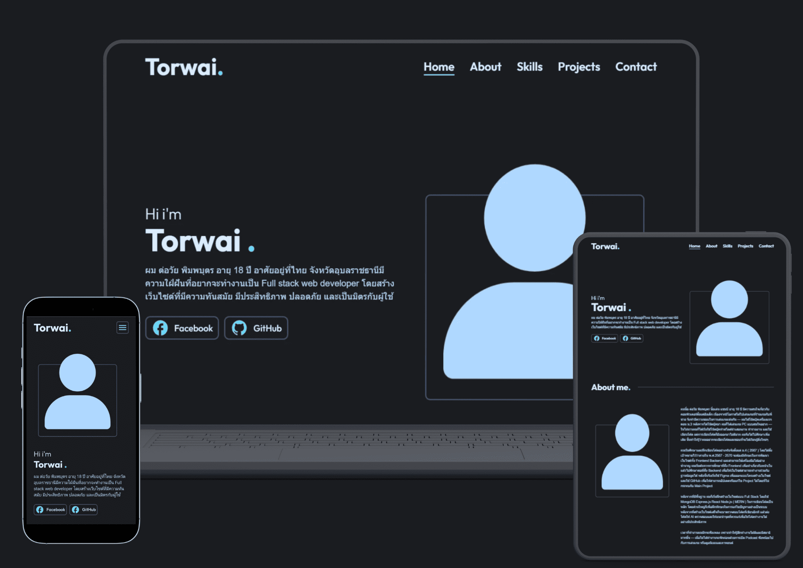

# My Personal Portfolio
เว็บไซต์ Portfolio ส่วนตัวที่สร้างขึ้นเพื่อแสดงทักษะ ผลงาน และวิธีการคิด 

## Live Demo
➡️ : https://torwai-portfolio.vercel.app

## Preview

## Features
- **Project Info** : ผู้ใช้สามารถเลือกดูข้อมูลเกี่ยวกับผลงานแต่ละชิ้นได้
- **Section Scroll** : สามารถกดปุ่มที่อยู่ขวาบนแล้วระบบจะพาไปยังส่วนที่เลือก
- **Send Email** : ระบบส่งข้อความหาเจ้าของเว็บไซต์ผ่านทางอีเมล
- **Responsive Design** : เว็บไซต์ถูกออกแบบมาให้สามารถใช้งานได้กับทุกอุปกรณ์

## Tech stack

  &emsp;
  &emsp;
  &emsp;

## Contact

  

## License
MIT
